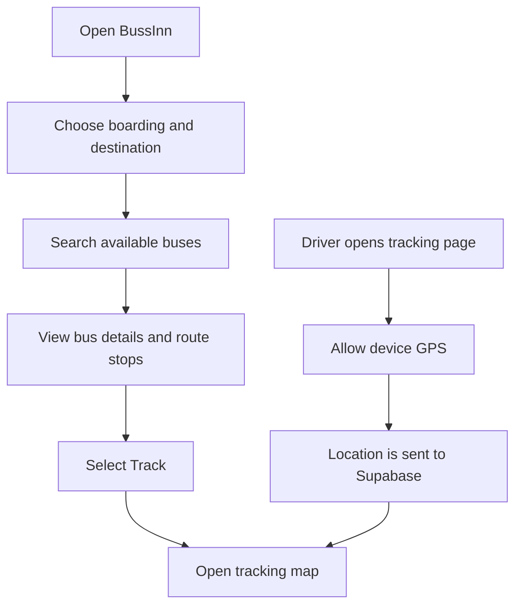

<div align="center">

#  BussInn Transit

### Smarter journeys. Better-connected cities.

**A smart public bus discovery, journey-planning, and live-tracking platform built to make everyday public transportation easier to use.**

<p>
  
  
  
  
</p>

Built by **Team Innovexiya** 

</div>

---

## 🌍 What is BussInn?

**BussInn Transit** is a public transportation web application designed to make bus travel more convenient, transparent, and accessible—especially for people travelling in Tier 2 and Tier 3 Buses

Finding the right bus, understanding its route, and knowing where it is can be difficult when transit information is scattered or unavailable. BussInn brings key journey information into one place, helping passengers explore available buses and routes while supporting live GPS tracking.

The project is being developed with a focus on practical usability, mobile-friendly screens, and a clear passenger and driver experience.

## ✨ Key Features

- 🔎 **Bus discovery:** Search for buses using boarding and destination stops.
- 🗺️ **Route and stop details:** View a bus's route and the stops between selected locations.
- 📍 **Live GPS tracking:** Share driver location and display live tracking information.
- 🧭 **Map-based experience:** Explore bus locations and routes through interactive maps.
- 🚍 **Passenger and driver flows:** Separate experiences for finding a bus and sharing its location.
- 🔄 **Live data updates:** Use Supabase and database subscriptions to keep supported location data updated.
- 📱 **Responsive interface:** Designed with mobile usability in mind.


> **Note:** BussInn is an active project. Feature availability depends on the current deployment, database configuration, and GPS permissions.

## 🧭 How it works



1. A passenger enters their boarding point and destination.
2. BussInn checks the available bus records and their stop information.
3. The passenger opens a bus route or selects the tracking option.
4. Where driver GPS tracking is active and configured, location updates can be shared through Supabase and displayed on the tracking experience.

## 🛠️ Technology Stack

| Technology | Purpose |
|---|---|
| **React** | Builds reusable UI components and interactive pages. |
| **Vite** | Provides the frontend development server and build tooling. |
| **TanStack Router** | Handles application routes and navigation. |
| **Tailwind CSS** | Supports utility-based styling where used in the UI. |
| **Framer Motion** | Adds interface animations where used. |
| **Supabase** | Provides the PostgreSQL database and realtime data capabilities. |
| **MapLibre GL JS** | Renders interactive maps in the browser. |
| **Lucide React** | Supplies consistent interface icons. |
| **Browser Geolocation API** | Reads device GPS location when the user grants permission. |

## 🧱 Architecture at a glance

```text
Passenger / Driver
        │
        ▼
 React + Vite Interface
        │
        ├── TanStack Router ──► App pages and navigation
        │
        ├── MapLibre GL JS ───► Interactive map
        │
        └── Supabase Client
                 │
                 ├── PostgreSQL bus and stop data
                 └── Live location data / realtime updates
```

The frontend communicates with Supabase through the Supabase JavaScript client. Bus schedules and stop information are stored in database tables, while configured tracking flows can publish and receive location updates. Browser location access requires user permission and a secure context such as HTTPS or localhost.

## 🚀 Getting Started

### Prerequisites

- [Node.js](https://nodejs.org/) (a current LTS version is recommended)
- npm
- A Supabase project with the required tables and permissions
- A modern browser

### 1. Clone the repository

```bash
git clone <YOUR_GITHUB_REPOSITORY_URL>
cd <YOUR_PROJECT_FOLDER>
```

Replace the placeholders with your repository URL and local folder name.

### 2. Install dependencies

```bash
npm install
```

### 3. Configure environment variables

Create a `.env` file in the project root and add your Supabase project credentials:

```env
VITE_SUPABASE_URL=your_supabase_project_url
VITE_SUPABASE_ANON_KEY=your_supabase_publishable_or_anon_key
```

Use the exact variable names expected by your Supabase client file. If your project uses a different key variable name, match that name instead.

**Security:** Never commit private keys, service-role keys, passwords, or real secrets to GitHub. Keep `.env` files out of version control and configure environment variables separately for deployment. Review Supabase Row Level Security (RLS) policies before exposing database access.

### 4. Start the development server

```bash
npm run dev
```

Open the local URL printed in your terminal—Vite commonly uses `http://localhost:5173`.

### 5. Build for production

```bash
npm run build
```

To preview a production build locally, if the project has the standard Vite preview script:

```bash
npm run preview
```

## 🔐 Configuration notes

- **Supabase:** Set up the bus, schedule/stop, and live-tracking tables expected by your current code. Column names and policies must match the queries in the application.
- **GPS:** Allow location access in the browser when testing driver tracking. On deployed sites, use HTTPS.
- **Maps:** Ensure the map style and tile service are reachable from the browser.
- **Realtime:** Enable/configure the required Supabase Realtime publication and permissions for any tables your application subscribes to.
- **Environment variables:** Use your deployment provider's environment settings for production values.

> This README describes the intended setup at a high level. Your exact database schema and environment variable names should be confirmed against the current source code.


## 👥 Team Innovexiya

Built with curiosity, collaboration, and a shared interest in solving everyday transit challenges.

| Team Member |
|---|
| **Vansh Kumar** |
| **Keshav Kumar** |
| **Vansh Rajput** |
| **Akash Kumar Singh** |

## 🎯 Our Vision

We want to make public transportation information easier to access and bus journeys easier to plan. BussInn is a step toward a more connected transit experience—one that helps passengers find their route and makes live bus information more useful.

## 🤝 Contributing

Contributions, suggestions, and bug reports are welcome. If you're contributing:

1. Fork the repository.
2. Create a feature branch: `git checkout -b feature/your-feature`.
3. Commit your changes with a clear message.
4. Push your branch and open a pull request.

Please avoid committing secrets or real user location data.


<div align="center">

###  BussInn Transit · Team Innovexiya

**Making every bus journey a little simpler.**

</div>
